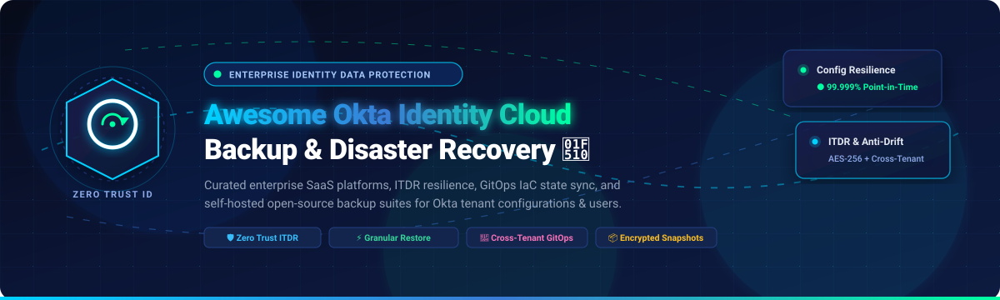

# Awesome-OKTA-Identity-Cloud-Backup-Recovery

  

# Awesome Okta Identity Cloud Backup & Recovery 

  
  
  
  

> 🛡️ A curated list of top Okta Identity Cloud Backup and Disaster Recovery solutions — featuring enterprise SaaS/Hosted data protection platforms, Identity Threat Detection & Recovery (ITDR) suites, GitOps/Terraform state exporters, and self-hosted open-source backup tools for safeguarding Okta configurations, users, groups, rules, and security policies against ransomware, account takeovers, accidental deletions, and tenant misconfigurations.
>
> 🌟 **Star this repo if you find it helpful!** 🌟

---

## 📋 Table of Contents

- [📈 Sector Overview & Market Dynamics](#-sector-overview--market-dynamics)
- [🟦 SaaS & Hosted Enterprise Platforms](#-saas--hosted-enterprise-platforms)
- [🟩 Open-Source & Self-Hosted Software](#-open-source--self-hosted-software)
- [🛡️ Architecture & Shared Responsibility Model](#️-architecture--shared-responsibility-model)
- [📊 Feature Comparison Matrix](#-feature-comparison-matrix)
- [⭐ Star History](#-star-history)
- [💖 Support & Sponsorship](#-support--sponsorship)
- [🤝 Contributing](#-contributing)
- [📄 License](#-license)

---

## 📈 Sector Overview & Market Dynamics

The global SaaS Data Protection & Recovery market is estimated at **$6.8B – $7.1B** (projected to reach **$18B+** by the early 2030s at an ~18% CAGR), while the adjacent Identity Threat Detection & Recovery (ITDR) market is valued at **$5.6B – $7.3B** expanding at 22%+ CAGR toward **$35B+**. 🌐

The sector exhibits **moderate concentration with rapid consolidation**: while hyperscaler-aligned multi-SaaS giants (such as AvePoint and Druva) and specialized identity-security unicorns (such as Semperis) lead enterprise market share, the market is transitioning from fragmented point utilities toward consolidated Zero Trust identity cyber resilience and API-driven automated recovery platforms. 🚀

---

## 🟦 SaaS & Hosted Enterprise Platforms

Enterprise-grade, cloud-hosted Okta Identity Cloud backup, disaster recovery, and identity posture management solutions. Sorted in descending order by company scale (market capitalization / enterprise valuation). 🏢

| Platform 🏢 | Company Scale (Valuation / Revenue) 💰 | Pricing (Starting Tier) 🏷️ | Free Tier / Trial Limit ⏳ | Key Focus & Recovery Capabilities ⚡ |
| :--- | :--- | :--- | :--- | :--- |
| **[AvePoint Cloud Backup](https://www.avepoint.com/products/cloud/backup)** | **~$3.5B Valuation** *(NASDAQ: AVPT, ~$488M TTM Rev)* | **$4.00 / user / month** *(Billed annually via cloud marketplace)* | **30-Day Free Trial** *(Full evaluation tenant access)* | High-frequency protection (up to 4x daily) for Okta configs, security settings, and app relationships with SOC 2 Type II / FedRAMP authorization. |
| **[Semperis Recovery for Okta](https://www.semperis.com/solutions/okta-recovery/)** | **~$1.5B – $2.5B Valuation** *(Private Unicorn, $100M+ ARR)* | **$10,000 / year base tier** *(Enterprise starting tier; scales by identity count)* | **No Free Tier / Custom Demo Only** *(Offers free audit tools Purple Knight & Forest Druid)* | Identity Threat Detection & Recovery (ITDR), real-time change forensics, continuous drift validation, and cross-IDP rollback. |
| **[Druva Okta Protection](https://www.druva.com/)** | **~$1.5B – $2.0B Valuation** *(Private, $200M+ ARR)* | **$8.00 / user / month** *(Entry SaaS protection tier)* | **30-Day Free Trial** *(Self-service evaluation tenant)* | Granular object restoration (single users, groups, apps) with explicit conflict handling (Skip/Overwrite/Merge) and JSON audit exports. |
| **[Keepit for Okta](https://www.keepit.com/services/okta-backup/)** | **~$500M – $700M Valuation** *(Private, $100M+ ARR)* | **$2.60 / user / month** *(Base seat tier, 3-yr commitment)* | **30-Day Free Trial** *(Full platform evaluation access)* | Independent vendor-neutral cloud storage with immutable blockchain-inspired backups, granular point-in-time recovery, and secondary-tenant failover. |
| **[HYCU for Okta](https://www.hycu.com/workloads/okta)** | **~$300M – $500M Valuation** *(Private, $140M Raised)* | **$1.20 / user / month** *(Workforce Identity Suite tier)* | **14-Day Free Trial** *(Waived service fees on R-Cloud)* | 1-click cross-tenant restore, ransomware-proof immutable retention, and unified identity protection covering Okta, Microsoft Entra ID, and AWS IAM. |

---

## 🟩 Open-Source & Self-Hosted Software

Community-driven, open-source utilities and self-hosted tools for exporting, versioning, migrating, and recovering Okta configurations and user access data. Sorted in descending order by GitHub stargazers count. 💻

| Project 🛠️ | GitHub_Stars ⭐ | Stack / Runtime ⚙️ | License 📜 | Description & Recovery Use Case 🔍 |
| :--- | :--- | :--- | :--- | :--- |
| **[GoogleCloudPlatform/terraformer](https://github.com/GoogleCloudPlatform/terraformer)** |  | Go / CLI | Apache-2.0 | CLI tool that generates Terraform files (`.tf`) and state from existing infrastructure. Supports Okta resource extraction for GitOps-driven configuration disaster recovery. |
| **[okta/terraform-provider-okta](https://github.com/okta/terraform-provider-okta)** |  | Go / Terraform | Apache-2.0 | Official HashiCorp Terraform provider for Okta. Enables Declarative Infrastructure-as-Code (IaC) configuration backup, drift management, and automated tenant restoration from Git. |
| **[okta/okta-sdk-python](https://github.com/okta/okta-sdk-python)** |  | Python | Apache-2.0 | Official Python client library for Okta Management APIs, widely used to write custom scheduled backup daemons, tenant synchronization pipelines, and disaster recovery scripts. |
| **[gabrielsroka/gabrielsroka.github.io](https://github.com/gabrielsroka/gabrielsroka.github.io)** |  | JavaScript / HTML | Open Source | Home of the **rockstar** browser extension for Okta admins. Enables fast client-side export of Okta users, groups, applications, group rules, and access assignments to CSV/JSON. |
| **[bbohen/okta-user-export](https://github.com/bbohen/okta-user-export)** |  | Python | MIT | CLI automation utility to export Okta users, attributes, and user-group memberships across organizations into structured formats for offline vaulting. |
| **[turbot/steampipe-plugin-okta](https://github.com/turbot/steampipe-plugin-okta)** |  | Go / Steampipe | Apache-2.0 | Query Okta users, groups, apps, and factor profiles using standard SQL. Useful for snapshotting Okta posture to SQLite/Postgres for change audit and config backups. |
| **[oktadev/okta-dev-account-migration-tool](https://github.com/oktadev/okta-dev-account-migration-tool)** |  | Java | Apache-2.0 | Okta-maintained migration utility (`envsync`) designed to backup, extract, and push tenant configurations across different Okta organizations and sandbox environments. |
| **[KelTech-Services/IdPVault](https://github.com/KelTech-Services/IdPVault)** |  | Python / PostgreSQL / Docker | AGPL-3.0 | Self-hosted encrypted backup, drift detection, and restore engine for Okta, Authentik, and Auth0. Provides AES-256-GCM snapshots, dry-run previews, clone/promote, and zero telemetry. |

---

## 🛡️ Architecture & Shared Responsibility Model

A common misconception in Identity & Access Management (IAM) is that cloud identity providers handle point-in-time configuration recovery. Under the **Cloud Shared Responsibility Model**: ⚖️

1. **Okta's Responsibility:** High availability, infrastructure resilience, physical multi-region data center failover, host security, and core API uptime. ☁️
2. **Customer's Responsibility:** Identity governance, user lifecycle states, tenant policies, app assignments, MFA enrollments, and protection against: 🔐
   - **Accidental Deletions:** Admin mistakes, bulk provisioning deactivations, or faulty SCIM sync rules. ⚠️
   - **Malicious Tampering & Ransomware:** Compromised super admin credentials, hijacked API tokens, or rogue Okta Workflow modifications. 🚨
   - **Configuration Drift:** Divergence across development, staging, and production identity tenants. 🔄

---

## 📊 Feature Comparison Matrix

| Solution 🛠️ | Model 🌐 | Primary Engine ⚙️ | Granular Restore 🎯 | Cross-Tenant Recovery 🔄 | Configuration Drift Detection 📡 | Self-Hosted Option 🏠 | Best For 🏆 |
| :--- | :--- | :--- | :--- | :--- | :--- | :--- | :--- |
| **AvePoint** | SaaS | Enterprise Cloud | ✅ | ⚠️ Custom | ❌ | ❌ | Multi-SaaS backup with high-frequency snapshots |
| **Semperis** | SaaS / Hybrid | Identity Engine | ✅ | ✅ Cross-IDP | ✅ Real-time | ❌ | Identity forensics, ITDR & compliance auditing |
| **Druva** | SaaS | AWS Cloud Fabric | ✅ | ⚠️ Same domain | ❌ | ❌ | Automated push restore with conflict resolution |
| **Keepit** | SaaS | Independent Cloud | ✅ | ✅ Secondary tenant | ❌ | ❌ | Vendor-neutral, immutable identity protection |
| **HYCU** | SaaS | R-Cloud Fabric | ✅ | ✅ Cross-tenant | ❌ | ❌ | Unified Okta + Entra ID + AWS IAM coverage |
| **IdPVault** | Open Source | Python / Postgres | ✅ Dry-run | ✅ Clone/Promote | ✅ | ✅ | Self-hosted encrypted snapshots & drift tracking |
| **Terraform + Provider** | Open Source | GitOps / HCL | ✅ Via code | ✅ Multi-tenant | ✅ State drift | ✅ | Declarative Infrastructure-as-Code recovery |

---

## 💖 Support & Sponsorship

Thank you for exploring and utilizing this curated directory! 🌟 

If you find this repository valuable for your organization, cloud security posture, or identity backup workflows:
- ⭐ **Star this repository** to show your appreciation and help other engineers discover it.
- 🍴 **Fork the repo** to contribute new solutions or customize it for your internal team's IAM guidelines.
- 📢 **Share it** on LinkedIn, X/Twitter, Discord, or Reddit with fellow DevOps, SecOps, and Identity engineers.
- ☕ **Support the maintainer:** If you'd like to fuel ongoing maintenance, curation, and research, consider buying a coffee via the [GitHub Sponsors Dashboard](https://github.com/sponsors/ishandutta2007).

---

## ⭐ Star History

---

## 🤝 Contributing

Contributions are warmly welcomed! 🤝 If you know of an open-source tool, script, or enterprise solution for Okta identity backup and recovery:

1. Fork this repository. 🍴
2. Add your entry following the established table structure. 📝
3. For open-source tools, include the live Stars_Count badge (`https://img.shields.io/github/stars/<owner>/<repo>?style=social&color=white`) linking to the stargazers page. ⭐
4. Submit a Pull Request with a short summary of capabilities and maintainer status. 🚀

---

## 📄 License

This repository and curated list are licensed under the [Creative Commons Zero v1.0 Universal](LICENSE) (Public Domain Dedication). ⚖️
